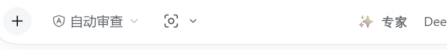
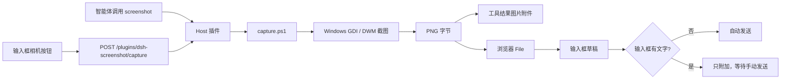

# DSH Screenshot / 截图上传

[English](README.en.md) | **简体中文**

给 [DeepSeek Harness](https://github.com/deepseek-ai/deepseek-harness)（DSH）用的截图插件：

- **智能体直接截图**：模型调用一次 `screenshot` 工具，截图立即作为图片附件进入当前对话。
- **输入框一键截图**：对话框工具栏里多一个相机按钮；点一下就能截图，不需要手动选文件、也不需要再点发送。
- **全屏 / 区域 / 窗口**：按钮菜单可选全屏、区域框选、窗口列表；智能体工具也支持这些范围。
- **屏蔽当前窗口**：截图时自动隐藏 DSH 窗口，截完恢复原来的位置、大小和焦点。

> Windows 10/11 · DSH Desktop · 第三方插件，非 DeepSeek 官方插件。



## 功能一览

| 能力 | 说明 |
|---|---|
| 智能体工具 `screenshot` | 一次调用完成截取 + 上传到对话，支持全屏、区域、窗口 |
| 输入框相机按钮 | 主按钮：一键截全屏；右侧 `⌄` 菜单：全屏 / 区域 / 窗口 |
| 全屏 | 默认截取整个虚拟桌面（所有显示器），也可指定 `primary` 或第 N 块屏 |
| 区域 | 先截全屏预览，在预览图上拖动框选，按原图像素裁剪 |
| 窗口 | 列出当前窗口（标题 + 进程名），选择后只截该窗口；最小化窗口会自动恢复 |
| 屏蔽 DSH 窗口 | `mask_self=true`，截图期间隐藏本窗口，截完恢复位置与焦点 |
| 有文字不自动发送 | 输入框有文字时，截图只附加到输入框；输入框为空时一键直接发送 |
| 多显示器 / 高 DPI | 使用物理像素坐标，支持 150% / 200% 缩放和多屏 |
| 本地处理 | 截图只在本机处理，不上传到任何第三方服务 |

## 安装

### 前置条件

- Windows 10 或 Windows 11
- 已安装 DSH Desktop，能打开 Web GUI
- Windows 自带的 PowerShell 5.1（无需额外安装）

### 安装步骤

1. 克隆本仓库到任意目录：

   ```powershell
   git clone https://github.com/yangmou2004/dsh-screenshot.git
   ```

2. 在 DSH 中安装这个本地 bundle。可以直接对 DSH 说：

   > 安装本地插件 `C:\path\to\dsh-screenshot`

   或者由 DSH 智能体调用：

   ```text
   plugin_manager install_bundle target = "C:\path\to\dsh-screenshot"
   ```

3. 安装完成后插件会自动启用。如果输入框里还没看到相机按钮，**刷新一次页面（F5）**。

> 插件包名是 `dsh-screenshot-plugin`；仓库目录名是 `dsh-screenshot`，两者不同是正常的。
> 安装的是本地目录，不需要 `npm install`，也没有构建步骤。

### 分享给别人

- 直接发仓库链接：<https://github.com/yangmou2004/dsh-screenshot>
- 或让对方下载 [Release 安装包](https://github.com/yangmou2004/dsh-screenshot/releases/latest)，解压后安装解压目录
- 详细步骤、系统要求和一段可直接复制的话见 [docs/INSTALL.md](docs/INSTALL.md)

## 使用

### 方式一：直接对智能体说

```text
截个图
截个全屏
截一下浏览器窗口
截取屏幕左上角 800×600 的区域
把聊天窗口屏蔽掉再截
```

智能体会调用 `screenshot` 工具，截图会作为图片附件出现在当前对话中。

### 方式二：输入框相机按钮

点相机图标：

- 输入框**为空**：截图并直接发送（一次点击完成）。
- 输入框**有文字**：只把截图加到输入框，不自动发送；按发送键时文字和截图一起发出。

点相机右侧的 `⌄` 打开菜单：

| 菜单项 | 行为 |
|---|---|
| 全屏（当前屏幕） | 自动屏蔽 DSH 窗口后截取整个桌面 |
| 区域（框选） | 先截一张全屏预览，在预览图上拖动框选，再点“发送截图” |
| 窗口… | 列出当前窗口，选择后截取该窗口 |

区域模式说明：为了避免 DSH 窗口挡住要截的内容，区域预览会先隐藏 DSH 窗口再截全屏，所以预览里看不到 DSH 窗口。想截 DSH 自身，请用“窗口…”里的 DSH 窗口。

## 智能体工具参数

工具名：`screenshot`

| 参数 | 类型 | 默认值 | 说明 |
|---|---|---|---|
| `mode` | `screen` \| `region` \| `window` | `screen` | 截图范围 |
| `region` | `{x,y,width,height,unit?}` | — | `mode=region` 时的区域；`unit` 为 `px` 或 `percent` |
| `window` | string | `active` | 窗口标题片段、`process:<名称>`、`pid:<n>`、`hwnd:<n>`、`active`、`self` |
| `monitor` | string | `all` | `all`、`primary` 或 1 开始的显示器序号 |
| `mask_self` | boolean | `false` | 截图时隐藏 DSH 窗口 |
| `delay_ms` | number | `120` | 截图前的额外等待时间（0–10000） |
| `save_to_workspace` | boolean | `true` | 是否另存到 `<workspace>/screenshots`；图片无论如何都会进入对话 |

工具返回时，截图已经作为图片内容块附加到当前对话，并带有一个 `attachmentId`；如果模型不能直接看图，可以用返回文本里的路径调用 `modlens_read_image`。

## 实现原理



- **Host**（`index.js`）：注册 `screenshot` 工具和本地截图路由，调用 `capture.ps1` 生成 PNG，再交给 `ctx.attachments` 保存为对话附件。
- **Capture**（`capture.ps1`）：使用 Windows GDI `CopyFromScreen` 和 DWM `PrintWindow` 截图；处理 DPI 缩放、多显示器、窗口边框、最小化恢复和窗口屏蔽。
- **Client**（`client.js`）：在 `conversation.input.left` 槽位注册相机按钮；通过同源 `fetch` 调用本地路由；把 PNG 变成浏览器 `File`，经 Conversation 服务放进草稿；输入框为空时调用 `inputActions.submit()` 发送。

### 安全与隐私

- 截图路由只监听 DSH 本机的 Web 服务（默认 `127.0.0.1`），请求必须带 `X-DSH-Screenshot: 1` 请求头。
- 截图不会上传到任何第三方服务；只写入 DSH 的附件存储和（可选的）工作区 `screenshots/` 目录。
- 窗口列表接口只返回本机窗口标题和进程名，不读取窗口内容。
- 插件不包含遥测、外链脚本或远程代码。

## 文件结构

```text
dsh-screenshot/
├── index.js              # Host：screenshot 工具、截图/窗口路由
├── client.js             # Web UI：相机按钮、菜单、区域框选、窗口选择
├── capture.ps1           # Windows 截图脚本（屏幕/区域/窗口/屏蔽/窗口列表）
├── cordis.patch.yml      # DSH Loader 补丁
├── package.json          # bundle + client 清单
├── locale/
│   ├── en.json           # 插件显示名和描述（英文）
│   └── zh.json           # 插件显示名和描述（中文）
├── icon.svg              # 插件图标
└── docs/assets/          # README 图片
```

## 开发与调试

- 纯 ESM Host 插件 + 懒加载 CJS Client 模块，不需要构建工具。
- 修改 `capture.ps1` 后下一次截图立即生效。
- 修改 `client.js` 后若页面没有自动热更新，刷新一次页面。
- 修改 `index.js` 后需要重新加载 Host 插件（禁用再启用，或重启 DSH）。
- 端口和路由：
  - `POST /plugins/dsh-screenshot/capture?mode=screen|region|window&mask_self=1`
  - `POST /plugins/dsh-screenshot/windows`
- 已在 DSH `0.2.1-rc.2` 上验证。

### 已知限制

- 仅支持 Windows；其他平台没有截图后端。
- 区域框选是在“先截全屏”的预览图上完成，不是原生桌面框选；因此截图内容以点击“区域”那一刻为准。
- 给已安装的插件新增 `dsh.client` 后，DSH 可能仍缓存旧清单；需要重启一次或更换包名重新安装。全新安装不会遇到这个问题。
- 窗口截图优先使用 `PrintWindow`，失败时会把目标窗口临时带到前台再截屏；可能造成一次短暂的前台切换。

## 常见问题

**输入框里没有相机按钮？**
刷新页面（F5），并确认“设置 → 插件”里 `dsh-screenshot-plugin` 是启用状态。

**有文字时点了按钮没有发送？**
这是预期行为：有文字时只把截图附加到输入框，按发送键才会一起发出去。

**截图时 DSH 窗口消失了一下？**
这是“屏蔽本窗口”的实现方式，截图完成后会自动恢复原来的位置和焦点。

**区域预览里看不到 DSH 窗口？**
区域预览会先屏蔽 DSH 再截全屏，所以预览里没有它。想截 DSH 自身，请用“窗口…”菜单。

## License

[MIT](LICENSE) © 2026 yangmou2004
